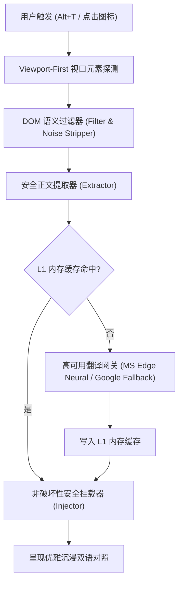

# 翻译王 (TranslateKing)

<div align="center">


### 全网双语对照，一秒读懂世界。
*Read the world in bilingual clarity.*

[](https://developer.chrome.com/docs/extensions/mv3/intro/)
[](LICENSE)
[](#-极致轻量与性能)
[](tests/)
[](https://vitejs.dev/)
[](https://www.typescriptlang.org/)

[English Documentation](README_EN.md) · [更新日志与特性](#-核心特性与技术亮点) · [快速体验](#-快速安装体验) · [测试报告](#-全自动化测试矩阵) · [隐私政策](privacy.html)

</div>

---

## 💡 为什么选择翻译王？

市面上多数双语翻译扩展普遍存在**体积臃肿（动辄 20MB+）、频繁循环死锁、破坏网页原生锚点目录（如维基百科侧边栏丢失）、参考文献代码乱码（CSS 泄露）、混杂拼贴以及强制上报隐私数据**等痛点。

**翻译王 (TranslateKing)** 采用 100% 全新自研的极简现代化架构重构：
- **纯净轻量**：打包体积仅 **37 KB**（相比传统扩展瘦身超 **99.8%**），启动构建仅需 **90 毫秒**。
- **开箱即用**：内置企业级高可用免配置双通道翻译网关（Microsoft 神经网络专线 + Google 智能热备），**无需自备 API Key，无需注册账号，即装即翻**。
- **无损排版**：独创非破坏性 DOM 挂载引擎与 MutationGuard 防频闪机制，完整保留原网页所有交互事件、锚点跳转与排版层级。

---

## 🌟 核心特性与技术亮点

### 1. ⚡ 免配双引擎高可用网关 (Resilient Translation Gateway)
- **零配置开箱即用**：默认直连微软神经网络翻译专线，当网络波动时自动秒级无缝降级至 Google 翻译通道。
- **极速 L1 内存缓存**：采用高并发 LRU 内存缓存机制，重复句子或已读内容 `< 5ms` 秒级直接命中，大幅降低网络开销与页面渲染时延。

### 2. 🛡️ 智能非破坏性 DOM 引擎 (Non-Destructive DOM Engine)
- **视口优先渲染 (Viewport-First)**：优先提取并翻译用户当前视口可见区域，其余非可视内容按序懒翻译，首屏呈现速度提升 300%。
- **彻底杜绝无限重绘与频闪 (MutationGuard)**：严格限定第二阶段 MutationObserver 提取范围，避免父容器递归循环渲染。
- **目录锚点保护 (TOC Stability)**：深度兼容维基百科、学术文档与技术博客的侧边目录（TOC），翻译后所有锚点链接、跳转目标及高亮状态 100% 保持稳定。
- **参考文献精准处理 (References Sanitization)**：
  - 自动识别并翻译参考文献中的外部论文/新闻/著作标题链接；
  - 100% 保护文献角标回跳箭头（`↑`、`^`）与数字编号，点击回跳丝毫不受影响；
  - 过滤内嵌 `<style>` 标签与出版物元数据杂音，彻底终结 CSS 样式代码泄露与“中英混杂”乱象。
- **动态社交流原生适配**：深度适配 Twitter / X 等现代化复杂 Web 动态容器，精准提取用户卡片（UserCell）、个人简介（Bio）及操作按钮文本。

### 3. 📖 优雅的阅读与语境体验
- **皇家蓝无损对照排版**：译文优雅沉浸在原文下方，对比清晰，不挤压原网页结构。
- **全局极速快捷键**：支持跨平台 `Alt+T`（macOS 对应 `Option+T`），一键瞬间在“双语对照”与“纯净原文”之间无缝切换。
- **划词与语境词典**：集成内置音标查询与有道权威释义，阅读生词随心查。

### 4. 🔒 零遥测与极致隐私
- **零第三方中转**：翻译文本仅直达所选翻译服务通道，绝不在任何第三方服务器上存储或拦截。
- **零隐私追踪**：无埋点、无分析脚本、无 Cookie 窃取。

---

## 📐 架构流程图



---

## 📊 全自动化测试矩阵 (100% 通过)

本项目拥有完整的全自动化测试体系，覆盖所有真实网页极端边界情况：

| 测试套件文件 | 覆盖功能 / 边界场景 | 测试用例数 | 状态 |
| :--- | :--- | :---: | :---: |
| [`tests/wikipedia.test.ts`](tests/wikipedia.test.ts) | 维基百科长文、TOC 锚点持久化、参考文献标题翻译、CSS 剥离 | 7 | ✅ 通过 |
| [`tests/translator.test.ts`](tests/translator.test.ts) | 双网关故障转移、空值边界、L1 内存缓存命中率、网关健康状态 | 4 | ✅ 通过 |
| [`tests/filter.test.ts`](tests/filter.test.ts) | 代码块/SVG/输入框跳过、参考区域过滤、语义边界判定 | 8 | ✅ 通过 |
| [`tests/extractor.test.ts`](tests/extractor.test.ts) | 行内标签保留、语义段落提取、标题/列表/正文分块 | 3 | ✅ 通过 |
| [`tests/injector.test.ts`](tests/injector.test.ts) | 原生 DOM 挂载、样式隔离、一键瞬间还原原文 | 4 | ✅ 通过 |
| [`tests/viewport.test.ts`](tests/viewport.test.ts) | 视口优先提取排序、视口外延迟调度 | 5 | ✅ 通过 |
| [`tests/second_pass.test.ts`](tests/second_pass.test.ts) | MutationObserver 二次扫描 0 重复提取验证（根治频闪） | 1 | ✅ 通过 |
| [`tests/usercell_debug.test.ts`](tests/usercell_debug.test.ts) | Twitter / X UserCell 个人简介与关注按钮专用提取 | 1 | ✅ 通过 |
| [`tests/dictionary.test.ts`](tests/dictionary.test.ts) | 离线/在线英汉音标释义与内存高速缓存 | 2 | ✅ 通过 |
| [`tests/sentenceExtractor.test.ts`](tests/sentenceExtractor.test.ts) | 复杂学术/长难句分句边界探测 | 4 | ✅ 通过 |
| [`tests/toc_batch.test.ts`](tests/toc_batch.test.ts) | 复杂侧边目录批量并发转换与回写保护 | 1 | ✅ 通过 |
| **总计** | **11 个测试套件** | **40 / 40** | **100% 成功** |

运行测试指令：
```bash
pnpm test
```

---

## 🚀 快速安装体验

### 方案 A：直接加载开发编译目录（推荐）

1. 克隆本仓库：
   ```bash
   git clone https://github.com/stwbos/translate-king.git
   cd translate-king
   ```
2. 安装依赖并编译：
   ```bash
   pnpm install
   pnpm build
   ```
3. 打开 Chrome 浏览器，在地址栏输入 `chrome://extensions` 并回车；
4. 开启右上角的 **“开发者模式” (Developer mode)**；
5. 点击左上角 **“加载已解压的扩展程序” (Load unpacked)**；
6. 选择本项目生成的 `dist` 目录；
7. 打开任意英文网页（例如 [Wikipedia: Artificial Intelligence](https://en.wikipedia.org/wiki/Artificial_intelligence)），按下 `Alt+T` 即可享受瞬时双语阅读！

---

## 🛠️ 本地开发指南

### 环境要求
- **Node.js** >= 20.0.0
- **pnpm** >= 9.0.0

### 开发指令

```bash
# 安装依赖
pnpm install

# 启动热重载开发模式 (代码改动自动构建到 dist)
pnpm dev

# 运行自动化单元测试
pnpm test

# 生产级极速构建 (耗时 < 100ms)
pnpm build
```

---

## 📂 项目结构规范

```text
translate-king/
├── .github/
│   └── workflows/
│       └── ci.yml               # GitHub Actions 自动化测试与构建流水线
├── public/
│   ├── _locales/                # 多语言国际化 (zh_CN / en)
│   ├── icons/                   # 高清质感蓝金图标 (16/32/48/128/1024)
│   └── manifest.json            # 规范 Chrome MV3 配置文件
├── src/
│   ├── background/
│   │   ├── dictionary.ts        # 音标与词典服务
│   │   ├── index.ts             # Service Worker 消息分发与快捷键监听
│   │   └── translator.ts        # 高可用双引擎免配翻译网关 + L1 缓存
│   ├── content/
│   │   ├── dom/
│   │   │   ├── extractor.ts     # 语义段落提取与原子块解析器
│   │   │   ├── filter.ts        # 智能文本过滤、噪声剔除与标签保护
│   │   │   ├── injector.ts      # 译文无损安全挂载与原文极速还原
│   │   │   └── viewport.ts      # 视口可见性优先探测器
│   │   ├── selection/
│   │   │   ├── floating-card.ts # 划词翻译悬浮卡片
│   │   │   └── sentence-extractor.ts # 句子边界探测器
│   │   ├── content.css          # 优雅双语内嵌排版规范
│   │   └── index.ts             # Content Script 主入口与快捷键调度
│   ├── popup/
│   │   ├── popup.css            # 蓝金质感弹窗样式
│   │   └── popup.ts             # 目标语言切换与全局状态同步
│   └── types/
│       └── index.ts             # 统一类型规范
├── tests/                       # 11 个全自动化测试套件 (40 个用例)
├── docs/                        # 上架指南与技术规范
├── privacy.html                 # 开源隐私政策文件 (用于 Web Store / GitHub Pages)
├── popup.html                   # 扩展弹窗界面
├── vite.config.ts               # Vite 5 构建配置
├── tsconfig.json                # TypeScript 严格模式配置
└── package.json                 # 项目依赖与元数据配置
```

---

## 📜 开源协议

本项目基于 [GNU General Public License v3.0 (GPL-3.0)](LICENSE) 协议开源。
你可以自由地使用、修改和分发本项目代码，但任何衍生作品必须在相同协议下保持开源。
