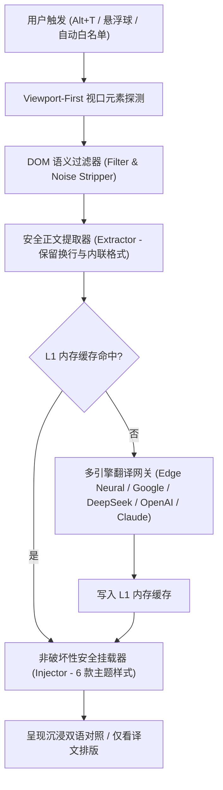

# 翻译王 (TranslateKing)

<div align="center">


### 全网双语对照，一秒读懂世界。
*Read the world in bilingual clarity.*

[](https://developer.chrome.com/docs/extensions/mv3/intro/)
[](LICENSE)
[](tests/)
[](https://vitejs.dev/)
[](https://www.typescriptlang.org/)

**[简体中文文档](README.md)** · **[English Documentation](README_EN.md)** · [沉浸式翻译调研报告](docs/IMMERSIVE_TRANSLATE_RESEARCH_REPORT.md) · [Monica 竞品调研报告](docs/MONICA_BENCHMARK_RESEARCH_REPORT.md) · [技术白皮书](docs/TECHNICAL_SPEC.md) · [核心优势](#-为什么选择翻译王) · [阅读模式与主题](#-两大阅读模式与-6-款译文主题) · [YouTube 视频双语字幕与总结](#-youtube-视频双语字幕与全时长总结) · [测试矩阵](#-全自动化测试矩阵-100-通过) · [隐私政策](privacy.html)

</div>

---

## 💡 为什么选择翻译王？

市面上多数双语翻译扩展普遍存在**体积臃肿（动辄 20MB+）、频繁循环死锁、破坏网页原生锚点目录（如维基百科侧边栏丢失）、YouTube 自动语音字幕（ASR）逐词蹦字闪烁、单页应用（SPA）切页串台以及强制上报隐私数据**等痛点。

**翻译王 (TranslateKing)** 采用 100% 自研的现代化纯净极简架构：
- **免配多引擎专线**：内置微软 Edge 神经网络翻译专线 + Google 智能热备网关，**无需自备 API Key，无需注册账号，即装即翻**；同时支持在设置中心接入 **DeepSeek AI、OpenAI (GPT-4o)、Anthropic Claude** 等大模型 API。
- **YouTube 沉浸式整句双语字幕 & 视频总结**：独创 MAIN 世界零破坏字幕流拦截器与 ASR 语义断句合并引擎（支持 `json3` / `srv1` / `srv3`），彻底告别自动字幕逐词蹦字与闪烁；内置覆盖 3+ 小时超长视频的时间轴章节总结与双语文字稿面板。
- **无损排版与换行保留**：采用非破坏性挂载与 MutationGuard 动态防护，100% 保留原网页交互事件、锚点跳转以及多行评论（如 YouTube 评论区）的段落换行结构。
- **零隐私追踪**：翻译请求由浏览器直连翻译网关，绝无任何中间服务器中转、拦截或行为上报。

---

## 🌓 两大阅读模式与 6 款译文主题

### 两大阅读模式
1. **沉浸式双语对照模式 (默认)**：在原文下方优雅插入高辨识度译文，保留原文与译文逐句对照，兼顾阅读理解与语言学习。
2. **仅看译文模式 (纯净替换)**：一键将外文替换为高质量译文，完整保留原网页换行排版、内联链接与按钮结构，适合快速摄取信息。
- **全局快捷键**：按下 `Alt+T`（macOS 对应 `Option+T`），或点击右侧**快捷悬浮球**，即可在任意网页秒级开启或复原。

### 6 款精选双语译文样式
在工具栏弹窗或全屏设置中心可实时切换并预览 6 种译文视觉风格：
- **经典引用边栏 (`blockquote`，默认)**：左侧皇家蓝竖线修饰 + 柔和微底，层次分明。
- **暖金护眼微底 (`warm`)**：琥珀暖金边栏与护眼微底，适合长文沉浸阅读。
- **纯净无框 (`clean`)**：无边框无底色，100% 继承原文的字体、字号与行高，宛如原生双语排版。
- **优雅虚线底边 (`dashed`)**：底部精致虚线勾勒，学术期刊与技术文档首选。
- **马克笔高亮 (`highlight`)**：柔光荧光笔底色标记重点译文。
- **学习模糊遮罩 (`mask`)**：译文默认高斯模糊隐藏，鼠标悬停时平滑显形，专为外语精读与听力训练打造。

---

## 🎬 YouTube 视频双语字幕与全时长总结

1. **控制栏原生融合 `[双语 ON | ⚙]` 复合开关**：
   - 自动挂载于 YouTube 播放器右下角控制栏最左侧，点击左侧一键开关双语字幕，点击右侧 `⚙` 呼出**双语字幕控制台**。
   - **多维实时调节**：支持切换「双语对照 / 仅看译文」、「译文在下 / 译文在上」、字号缩放（`80% ~ 145%`）、5 种高对比字幕颜色（电影暖黄、纯净亮白、冰晶青蓝、护眼翠绿、柔和粉紫）、背景不透明度、听力模糊遮罩、鼠标悬停自动暂停视频，以及**一键导出双语 `.SRT` 字幕文件**。
2. **ASR 自动语音字幕整句合并与零闪烁渲染**：
   - 自动识别 YouTube 逐词滚动字幕（`.ytp-caption-window-rollup`）与 `fmt=srv3` / `json3` 词流，按停顿阈值与语义标点重组为完整长句，并通过滑动窗口调度器（`SubtitleScheduler`）提前按批次预翻译。
   - 字幕容器严格锁定在视频画面内部居中安全区（最大宽度 86% 自动折行），通过 CSS 父级遮蔽消除逐词蹦字与画面闪烁。
3. **全时长 AI 视频总结与双语时间轴文字稿 (`[✨ 视频总结]`)**：
   - 动态计算视频总跨度（完美支持 5 分钟短视频至 3+ 小时超长访谈/公开课），智能划分为 ~24 个时间轴章节要点与连贯双语段落。
   - 点击任意 `[MM:SS]` / `[H:MM:SS]` 时间戳徽章直接跳转至对应视频秒数播放，支持一键复制完整双语文字稿。
   - 具备严格的 `videoId` 强绑定与 `popstate` 回退路由隔离，切换视频绝不串台。

---

## 🔍 划词精读、生词本与三击空格输入翻译

- **视口防溢出划词浮窗**：在页面划选任意单词或长句，Shadow DOM 隔离浮窗即刻呈现；内置真实 DOM 边界测量与内部滚动容器，靠近屏幕边缘自动反向吸附，绝不超出视口。
- **权威释义、双音标与真人朗读**：集成英美双音标、词性释义、真人语音发音（TTS）及上下文整句翻译，支持中英双向互查与本地生词本收藏。
- **三击空格输入框实时翻译 (`Space × 3`)**：在任意网页输入框、`textarea` 或富文本编辑器（Twitter/X、GitHub、Discord、Gmail 等）中输入文本后**连续敲击三下空格键**，即可瞬间将输入内容原位翻译为目标语言（默认地道英文）。

---

## ⚙️ 全屏设置中心与多引擎接入

点击弹窗右上角齿轮或管理按钮即可打开对标主流旗舰扩展的**全屏设置中心 (`options.html`)**：
- **常规设置**：源语言/目标语言、默认翻译模式、三击空格输入翻译开关、划词浮窗开关、右侧快捷悬浮球开关。
- **翻译服务 (AI 引擎)**：支持免配内置专线、Google 翻译，以及自定义配置 **DeepSeek (`deepseek-chat`)、OpenAI (`gpt-4o-mini` / `gpt-4o`)、Claude (`claude-3-5-sonnet`)** 的 API Key 与 Base URL，并提供一键连通性测试。
- **网站规则与配置备份**：支持按域名配置「总是自动翻译白名单」与「永不翻译黑名单」，支持全量设置与生词本 JSON 一键导出备份与导入恢复。

---

## 📐 架构流程图



---

## 📊 全自动化测试矩阵 (100% 通过)

本项目拥有完整的全自动化单元测试体系（20 个测试套件，96 项测试用例），全面覆盖网页翻译、YouTube 视频字幕与极端边界场景：

| 测试套件文件 | 覆盖功能 / 边界场景 | 测试用例数 | 状态 |
| :--- | :--- | :---: | :---: |
| [`tests/youtube_observer.test.ts`](tests/youtube_observer.test.ts) | YouTube 原生双语字幕注入、ASR `srv3` 整句接管、多维字幕控制台、3 小时总结全覆盖、SPA 切视频隔离 | 11 | ✅ 通过 |
| [`tests/youtube_extractor.test.ts`](tests/youtube_extractor.test.ts) | YouTube 字幕轨道选拔、ASR 逐词流断句合并、`json3`/`xml` 自适应解析 | 9 | ✅ 通过 |
| [`tests/youtube_overlay.test.ts`](tests/youtube_overlay.test.ts) | YouTube 字幕图层挂载、悬停自动暂停、样式隔离与销毁还原 | 6 | ✅ 通过 |
| [`tests/youtube_scheduler.test.ts`](tests/youtube_scheduler.test.ts) | 滑动窗口按需预读（120s 视野 / 30 句分批）、二分时间轴快查、Seek 进度抢占 | 4 | ✅ 通过 |
| [`tests/twitter_dm.test.ts`](tests/twitter_dm.test.ts) | Twitter 私信聊天气泡、发送者昵称、时间戳、操作按钮自适应翻译 | 10 | ✅ 通过 |
| [`tests/filter.test.ts`](tests/filter.test.ts) | 代码块/SVG/输入框跳过、参考文献过滤、语义边界判定 | 9 | ✅ 通过 |
| [`tests/wikipedia.test.ts`](tests/wikipedia.test.ts) | 维基百科长文、TOC 锚点持久化、参考文献标题翻译、CSS 剥离 | 7 | ✅ 通过 |
| [`tests/selection.test.ts`](tests/selection.test.ts) | 划词翻译选区探测、视口防溢出边界计算、防抖与清理逻辑 | 5 | ✅ 通过 |
| [`tests/viewport.test.ts`](tests/viewport.test.ts) | 视口优先提取排序、视口外延迟调度 | 5 | ✅ 通过 |
| [`tests/translator.test.ts`](tests/translator.test.ts) | 多网关故障转移、空值边界、L1 内存缓存命中率、网关健康状态 | 4 | ✅ 通过 |
| [`tests/injector.test.ts`](tests/injector.test.ts) | 原生 DOM 挂载、多行换行 `<br>` 保留、一键瞬间还原原文、按钮就地替换 | 4 | ✅ 通过 |
| [`tests/dictionary.test.ts`](tests/dictionary.test.ts) | 英汉/汉英双向音标释义、真人音频流与内存高速缓存 | 4 | ✅ 通过 |
| [`tests/sentenceExtractor.test.ts`](tests/sentenceExtractor.test.ts) | 复杂学术/长难句分句边界探测 | 4 | ✅ 通过 |
| [`tests/extractor.test.ts`](tests/extractor.test.ts) | 行内标签保留、多行评论换行提取、标题/列表/正文分块 | 3 | ✅ 通过 |
| [`tests/second_pass.test.ts`](tests/second_pass.test.ts) | MutationObserver 二次扫描 0 重复提取验证（根治重复翻译与频闪） | 3 | ✅ 通过 |
| [`tests/twitter_spa_sidebar.test.ts`](tests/twitter_spa_sidebar.test.ts) | Twitter SPA 单页路由切换、侧边栏持久化与生命周期复用 | 3 | ✅ 通过 |
| [`tests/zhihu_richtext.test.ts`](tests/zhihu_richtext.test.ts) | 知乎富文本加粗段落与内嵌搜索词超链接穿透替换 | 2 | ✅ 通过 |
| [`tests/toc_batch.test.ts`](tests/toc_batch.test.ts) | 复杂侧边目录批量并发转换与回写保护 | 1 | ✅ 通过 |
| [`tests/usercell_debug.test.ts`](tests/usercell_debug.test.ts) | Twitter / X UserCell 个人简介与关注按钮专用提取 | 1 | ✅ 通过 |
| [`tests/twitter_dm_screenshot.test.ts`](tests/twitter_dm_screenshot.test.ts) | Twitter 聊天视觉排版稳定性与截图回归 | 1 | ✅ 通过 |
| **总计** | **20 个测试套件** | **96 / 96** | **100% 成功** |

运行测试指令：
```bash
pnpm test
```

---

## 🚀 快速安装体验

### 直接加载编译目录（推荐）

1. 克隆本仓库：
   ```bash
   git clone https://github.com/stwbos/translate-king.git
   cd translate-king
   ```
2. 安装依赖并编译：
   ```bash
   pnpm install
   pnpm build
   ```
3. 打开 Chrome 浏览器，在地址栏输入 `chrome://extensions` 并回车；
4. 开启右上角的 **“开发者模式” (Developer mode)**；
5. 点击左上角 **“加载已解压的扩展程序” (Load unpacked)**；
6. 选择本项目生成的 `dist` 目录；
7. 打开任意网页或 YouTube 视频，按下 `Alt+T` 即可享受瞬时双语体验！

---

## 🛠️ 本地开发指南

```bash
# 安装依赖
pnpm install

# 启动热重载开发模式
pnpm dev

# 运行全套自动化单元测试 (96 项)
pnpm test

# 生产级极速构建
pnpm build
```

---

## 📂 项目结构规范

```text
translate-king/
├── .github/
│   └── workflows/
│       └── ci.yml                  # GitHub Actions 自动化测试与构建流水线
├── public/
│   ├── _locales/                   # 多语言国际化 (zh_CN / en)
│   ├── icons/                      # 高清质感图标 (16/32/48/128/1024)
│   └── manifest.json               # Chrome MV3 扩展清单配置
├── src/
│   ├── background/
│   │   ├── dictionary.ts           # 英汉/汉英双向音标词典服务
│   │   ├── index.ts                # Service Worker 消息路由与快捷键分发
│   │   └── translator.ts           # 多引擎翻译网关 (内置专线 + Google + LLM API) & L1 缓存
│   ├── content/
│   │   ├── dom/
│   │   │   ├── extractor.ts        # 语义段落与多行换行提取器
│   │   │   ├── filter.ts           # 智能文本过滤、噪声剔除与标签保护
│   │   │   ├── injector.ts         # 6 款主题译文无损挂载与原文极速还原
│   │   │   └── viewport.ts         # 视口可见性优先探测器
│   │   ├── selection/
│   │   │   ├── floating-card.ts    # Shadow DOM 视口防溢出划词卡片与生词本
│   │   │   └── sentence-extractor.ts # 上下文句子边界探测器
│   │   ├── youtube/
│   │   │   ├── extractor.ts        # YouTube 字幕嗅探与 ASR 整句断句合并器 (json3/srv1/srv3)
│   │   │   ├── index.ts            # YouTube 控制栏复合按钮与生命周期总控
│   │   │   ├── native-observer.ts  # 原生与 ASR 整句双语字幕防闪烁渲染引擎
│   │   │   ├── overlay.ts          # 自适应双语字幕叠加层
│   │   │   ├── scheduler.ts        # 滑动窗口按需预读与二分时间轴调度器
│   │   │   ├── subtitle-menu.ts    # 播放器内多维字幕设置控制台与 SRT 导出
│   │   │   ├── summary-panel.ts    # 全时长 AI 视频章节总结与双语时间轴文字稿面板
│   │   │   └── yt-bridge.ts        # MAIN 世界零副作用字幕流被动拦截桥接器
│   │   ├── floating-ball.ts        # 页面右侧可拖拽双语快捷悬浮球
│   │   ├── input-translate.ts      # 三击空格 (Space×3) 输入框实时翻译引擎
│   │   ├── content.css             # 6 款双语内嵌主题排版样式
│   │   └── index.ts                # Content Script 主入口与 SPA 路由守卫
│   ├── options/
│   │   ├── options.css             # 全屏设置中心样式
│   │   └── options.ts              # 全屏设置中心交互逻辑 (常规/AI 引擎/视频字幕/规则/备份)
│   ├── popup/
│   │   ├── popup.css               # 扩展弹窗界面样式
│   │   └── popup.ts                # 弹窗快捷控制与实时样式预览
│   └── types/
│       └── index.ts                # 全局统一类型定义
├── tests/                          # 20 个全自动化测试套件 (96 个单元测试用例)
├── docs/                           # 技术白皮书与 Chrome 商店上架指南
├── options.html                    # 独立全屏设置中心页面
├── popup.html                      # 扩展工具栏弹窗页面
├── privacy.html                    # 开源隐私政策声明
├── vite.config.ts                  # Vite 5 构建与单文件 Content Script 打包配置
├── tsconfig.json                   # TypeScript 严格模式配置
└── package.json                    # 项目依赖与脚本配置
```

---

## 📜 开源协议

本项目基于 [GNU General Public License v3.0 (GPL-3.0)](LICENSE) 协议开源。
