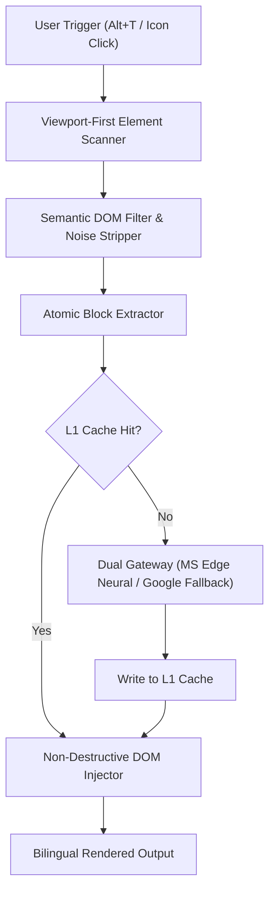

# TranslateKing

<div align="center">


### Read the world in bilingual clarity.
*An ultra-lightweight, zero-config, non-destructive bilingual translation Chrome extension.*

[](https://developer.chrome.com/docs/extensions/mv3/intro/)
[](LICENSE)
[](#-ultra-lightweight--performance)
[](tests/)
[](https://vitejs.dev/)
[](https://www.typescriptlang.org/)

**[简体中文文档](README.md)** · **[English Documentation](README_EN.md)** · [Key Features](#-key-features) · [Reading Modes](#-reading-modes) · [Selection Lookup](#-selection-lookup--vocabulary) · [Architecture](#-architecture) · [Quick Start](#-quick-start) · [Test Matrix](#-automated-testing-matrix-100-passed) · [Privacy Policy](privacy.html)

</div>

---

## 💡 Why TranslateKing?

Most bilingual web translation extensions suffer from **excessive bundle sizes (20MB+), infinite DOM mutation loops, broken Table of Contents (TOC) sidebars, garbled CSS stylesheet leaks in references, and intrusive tracking**.

**TranslateKing** is built from scratch with a clean, high-performance, resilient architecture:
- **Ultra-lightweight**: Production bundle is only **37 KB** (over **99.8% smaller** than legacy extensions), cold-builds in **<100ms**.
- **Zero-configuration**: High-availability dual-channel translation gateway (Microsoft Edge Neural + Google Translate Fallback) works out of the box with **no API keys or accounts required**.
- **Non-destructive layout**: Preserves all native DOM nodes, event listeners, and navigation anchors without layout breakage.
- **100% Private**: Direct gateway communication with zero intermediate telemetry, proxies, or user tracking.

---

## 🌓 Reading Modes

TranslateKing offers two versatile reading experiences:

1. **Bilingual Mode (Default)**: Elegantly injects royal blue contrast translations directly below the original text, providing seamless sentence-by-sentence side-by-side reading.
2. **Direct Replace Mode**: Replaces original foreign text with accurate translations in place while preserving original fonts, layouts, and interactive buttons.
- **Instant Toggle**: Use the global shortcut `Alt+T` (or `Option+T` on macOS) to instantly toggle bilingual mode on/off on any webpage.

---

## 🔍 Selection Lookup & Vocabulary

- **Interactive Floating Card**: Select any word or sentence on the page to open a lightweight dictionary popup.
- **Phonetics & Audio Pronunciation**: View UK/US phonetic symbols and click to hear native pronunciations powered by Youdao audio streams.
- **Contextual Sentence Translation**: Translates the full surrounding sentence to give accurate in-context meaning.
- **One-Click Wordbook**: Star unfamiliar words to save them to your local vocabulary book for spaced repetition.
- **Bidirectional Support**: Look up English words to see Chinese definitions, or select Chinese text to view Pinyin, English definitions, and English sentence translations.

---

## 🌍 Global Multi-Language & Bidirectional Translation

TranslateKing is **not limited to English-to-Chinese**—it supports seamless **bidirectional translation between all major world languages**:

- **Intelligent Source Auto-Detection**: The underlying neural gateways automatically detect the source language (English, Chinese, Japanese, Korean, French, German, Spanish, Russian, etc.) without requiring manual input.
- **Switch Target Language Anytime**: Click the extension icon to select your desired target language:
  - **Foreign to Chinese**: Browse BBC, Wikipedia, Twitter/X, Reddit, or GitHub with instant bilingual reading.
  - **Chinese to English**: Open Chinese websites (Zhihu, Baidu, tech blogs), set the target language to `English`, and read them in clean bilingual format.
  - **Other Language Pairs**: Japanese to Chinese, Korean to English, French to German, and more.

---

## 🌟 Key Features

### 1. ⚡ High-Availability Dual Gateway
- **Zero-config instant access**: Built-in Microsoft Edge Neural translation channel with automatic failover to Google Translate.
- **L1 In-Memory Cache**: LRU cache delivers `< 5ms` instant hits for repeated sentences, minimizing latency and network traffic.

### 2. 🛡️ Resilient DOM Architecture
- **Viewport-First Scheduling**: Detects and translates visible text in the viewport first for immediate reading; offscreen content is deferred.
- **MutationGuard Anti-Flicker**: Prevents runaway DOM mutation loops and flickering during dynamic page updates.
- **Protected Table of Contents (TOC)**: Deeply optimized for Wikipedia, technical docs, and academic papers—ensures sidebar links, scrollspy anchors, and headings remain 100% stable.
- **Reference Section Sanitization**:
  - Automatically identifies and translates external article/paper titles in citation references.
  - 100% preserves footnote backlink arrows (`↑`, `^`) and numbering for seamless jump-back navigation.
  - Strips embedded `<style>` tags and metadata noise, eliminating CSS code leakage.
- **Dynamic Social & SPA Routing**: Native support for Twitter / X UserCells, profile bios, direct messages (DM chats), and single-page navigation without stale states or sidebar loss.

### 3. 🔒 Privacy by Design
- **No telemetry**: Zero tracking, zero user profiling, zero analytics.
- **Direct connections**: Translation requests travel directly between your browser and the translation gateways—no intermediate proxy servers.

---

## 📐 Architecture



---

## 📊 Automated Testing Matrix (100% Passed)

| Test Suite | Scope & Boundary Tests | Count | Status |
| :--- | :--- | :---: | :---: |
| [`tests/wikipedia.test.ts`](tests/wikipedia.test.ts) | Full Wikipedia articles, TOC anchor stability, reference links, CSS stripping | 7 | ✅ Passed |
| [`tests/translator.test.ts`](tests/translator.test.ts) | Gateway failover, empty array safety, L1 cache hit, gateway health | 4 | ✅ Passed |
| [`tests/filter.test.ts`](tests/filter.test.ts) | Code blocks, SVG, forms, citation anchors, semantic boundaries | 8 | ✅ Passed |
| [`tests/extractor.test.ts`](tests/extractor.test.ts) | Inline tag preservation, semantic block extraction | 3 | ✅ Passed |
| [`tests/injector.test.ts`](tests/injector.test.ts) | Non-destructive insertion, isolated CSS, instant rollback, button replacement | 4 | ✅ Passed |
| [`tests/viewport.test.ts`](tests/viewport.test.ts) | Viewport-first priority queue sorting | 5 | ✅ Passed |
| [`tests/second_pass.test.ts`](tests/second_pass.test.ts) | MutationObserver second-pass zero re-extraction (anti-flicker) | 1 | ✅ Passed |
| [`tests/usercell_debug.test.ts`](tests/usercell_debug.test.ts) | Twitter / X UserCell bios and action buttons extraction | 1 | ✅ Passed |
| [`tests/dictionary.test.ts`](tests/dictionary.test.ts) | Phonetics, definition lookups, audio streams, and memory caching | 4 | ✅ Passed |
| [`tests/sentenceExtractor.test.ts`](tests/sentenceExtractor.test.ts) | Complex academic sentence boundary segmentation | 4 | ✅ Passed |
| [`tests/toc_batch.test.ts`](tests/toc_batch.test.ts) | Concurrent sidebar TOC item extraction and injection | 1 | ✅ Passed |
| [`tests/zhihu_richtext.test.ts`](tests/zhihu_richtext.test.ts) | Zhihu rich text formatting, nested links inside bold paragraphs, replace mode | 2 | ✅ Passed |
| [`tests/twitter_dm.test.ts`](tests/twitter_dm.test.ts) | Twitter DM chat messages, sender bubbles, timestamps, action buttons | 10 | ✅ Passed |
| [`tests/twitter_dm_screenshot.test.ts`](tests/twitter_dm_screenshot.test.ts) | Twitter chat visual screenshot regression and in-place layout stability | 1 | ✅ Passed |
| [`tests/twitter_spa_sidebar.test.ts`](tests/twitter_spa_sidebar.test.ts) | Twitter SPA client navigation, persistent sidebar, re-entry lifecycle | 3 | ✅ Passed |
| [`tests/selection.test.ts`](tests/selection.test.ts) | Word & sentence selection detection, range boundaries, debounce | 5 | ✅ Passed |
| **Total** | **16 Test Suites** | **63 / 63** | **100% Passed** |

Run tests locally:
```bash
pnpm test
```

---

## 🚀 Quick Start

1. Clone this repository:
   ```bash
   git clone https://github.com/stwbos/translate-king.git
   cd translate-king
   ```
2. Install dependencies & build:
   ```bash
   pnpm install
   pnpm build
   ```
3. Open Google Chrome and navigate to `chrome://extensions`;
4. Enable **Developer mode** in the top-right corner;
5. Click **Load unpacked** in the top-left corner;
6. Select the `dist` directory created in step 2;
7. Open any webpage and press `Alt+T` (or `Option+T` on macOS) to start reading!

---

## 🛠️ Development

```bash
# Install dependencies
pnpm install

# Start development mode with hot reload
pnpm dev

# Run unit tests
pnpm test

# Build production bundle (<100ms)
pnpm build
```

---

## 📜 License

This project is licensed under the [GNU General Public License v3.0 (GPL-3.0)](LICENSE).
