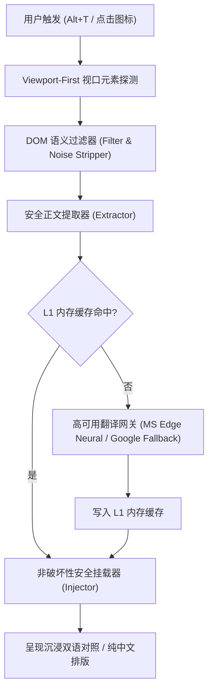

# 翻译王 (TranslateKing) 简体中文文档

> 📌 **提示**：本项目主文档已全面采用中文优先！您可以直接查阅根目录及主文档：[README.md](README.md)，英文文档请见 [README_EN.md](README_EN.md)。

---

<div align="center">


### 全网双语对照，一秒读懂世界。
*Read the world in bilingual clarity.*

[](https://developer.chrome.com/docs/extensions/mv3/intro/)
[](LICENSE)
[](#-极致轻量与性能)
[](tests/)
[](https://vitejs.dev/)
[](https://www.typescriptlang.org/)

**[简体中文主文档](README.md)** · **[English Documentation](README_EN.md)** · [核心优势](#-为什么选择翻译王) · [阅读模式](#-两大核心阅读模式) · [划词精读与生词本](#-划词精读与生词本) · [全网动态适配](#-全网高动态场景深度适配) · [架构流程图](#-架构流程图) · [测试矩阵](#-全自动化测试矩阵-100-通过) · [快速体验](#-快速安装体验) · [隐私政策](privacy.html)

</div>

---

## 💡 为什么选择翻译王？

市面上多数双语翻译扩展普遍存在**体积臃肿（动辄 20MB+）、频繁循环死锁、破坏网页原生锚点目录（如维基百科侧边栏丢失）、参考文献代码乱码（CSS 泄露）、单页应用（SPA）切页失效以及强制上报隐私数据**等痛点。

**翻译王 (TranslateKing)** 采用 100% 自研的现代化纯净极简架构：
- **纯净轻量**：生产打包体积仅 **37 KB**（相比传统扩展瘦身超 **99.8%**），冷启动构建仅需 **<100ms**。
- **免配双专线**：内置微软 Edge 神经网络翻译专线 + Google 智能热备网关，**无需自备 API Key，无需注册账号，即装即翻**。
- **无损排版**：采用非破坏性挂载与 MutationGuard 动态防护，完整保留原网页所有交互事件、锚点跳转与排版层级。
- **零隐私追踪**：翻译请求由浏览器直连官方网关，绝无任何中间服务器中转、拦截或行为上报。

---

## 🌓 两大核心阅读模式

翻译王提供两种不同的沉浸式阅读体验，适应不同场景与阅读偏好：

1. **沉浸式双语对照模式 (默认)**：
   在原文下方优雅插入皇家蓝高对比译文，保留原文与译文逐句对照，兼顾阅读理解与语言学习。
2. **纯中文直接替换模式**：
   一键将外文替换为高质量中文，完美复刻原生段落样式与按钮排版，适合快速摄取信息。
- **全局快捷键**：按下 `Alt+T`（macOS 对应 `Option+T`），即可在任意网页瞬间秒级开启或复原。

---

## 🔍 划词精读与生词本

不仅能全篇翻译，更为深度学习者量身定制了精读辅助能力：

- **极速划词浮窗**：在页面上划选任意单词或长句，悬浮卡片即刻呈现，无需复制跳转。
- **权威释义与音标**：集成有道词典英汉/汉英权威释义，标注文中词性及英美双音标。
- **真人语音朗读**：卡片内置发音按钮，点击即可直接调用真人原声朗读。
- **整句语境翻译**：智能识别所选词汇所在的完整上下文长句，给出上下文地道译文。
- **一键生词本收藏**：点击浮窗星标按钮，轻松将陌生词汇收录至本地生词本，支持温故知新。
- **中英双向互查**：划选英文查中文，划选中文字词自动查询拼音、英文对照释义与整句英文翻译。

---

## 🌍 全球多语言自动识别与双向互译

- **源语言全自动智能探测（Auto-Detect）**：底层专线自动识别源语言（英文、中文、日文、韩文、法文、德文、西班牙文、俄文等），无需手动指定源语言。
- **目标语言自由切换**：点击插件图标，可一键切换目标语言：
  - **英翻中**：浏览 BBC、Wikipedia、Twitter/X、GitHub、Reddit 等外文网站，一秒呈现双语对照；
  - **中翻英**：打开知乎、掘金、国内技术博客，目标语言切换为 `English`，即可直接将中文网页翻译为英文对照；
  - **小语种互译**：支持日译中、韩译中、德译英、法译中等任意语言对。

---

## 🛡️ 全网高动态场景深度适配

1. **Twitter / X 深度适配**：
   - 完美适配聊天会话窗口（Direct Messages / 私信），消息气泡、发送者昵称、时间戳与操作按钮自适应翻译。
   - 提取并翻译用户卡片（UserCell）、个人简介（Bio）及关注按钮。
2. **单页应用 (SPA) 路由感知**：
   - 在 Twitter/X、GitHub、Notion 等单页应用中切换路由页面（如从私信聊天切回探索页或个人主页），状态自动维护，导航与侧边栏永不失效。
3. **维基百科目录 (TOC) 与参考文献保护**：
   - 深度保护维基百科侧边目录（TOC），翻译后所有锚点链接、跳转目标及高亮状态 100% 保持稳定。
   - 自动识别并翻译参考文献外部标题链接；保护角标回跳箭头（`↑`、`^`）与数字编号；过滤内嵌 `<style>` 标签，彻底终结 CSS 样式泄露。
4. **知乎富文本穿透**：
   - 深度解析嵌套加粗段落与内嵌搜索词超链接，实现无损替换。

---

## 📐 架构流程图



---

## 📊 全自动化测试矩阵 (100% 通过)

本项目拥有完整的全自动化测试体系，覆盖真实网页复杂 DOM 结构与极端边界情况：

| 测试套件文件 | 覆盖功能 / 边界场景 | 测试用例数 | 状态 |
| :--- | :--- | :---: | :---: |
| [`tests/wikipedia.test.ts`](tests/wikipedia.test.ts) | 维基百科长文、TOC 锚点持久化、参考文献标题翻译、CSS 剥离 | 7 | ✅ 通过 |
| [`tests/translator.test.ts`](tests/translator.test.ts) | 双网关故障转移、空值边界、L1 内存缓存命中率、网关健康状态 | 4 | ✅ 通过 |
| [`tests/filter.test.ts`](tests/filter.test.ts) | 代码块/SVG/输入框跳过、参考区域过滤、语义边界判定 | 8 | ✅ 通过 |
| [`tests/extractor.test.ts`](tests/extractor.test.ts) | 行内标签保留、语义段落提取、标题/列表/正文分块 | 3 | ✅ 通过 |
| [`tests/injector.test.ts`](tests/injector.test.ts) | 原生 DOM 挂载、样式隔离、一键瞬间还原原文、交互按钮就地替换 | 4 | ✅ 通过 |
| [`tests/viewport.test.ts`](tests/viewport.test.ts) | 视口优先提取排序、视口外延迟调度 | 5 | ✅ 通过 |
| [`tests/second_pass.test.ts`](tests/second_pass.test.ts) | MutationObserver 二次扫描 0 重复提取验证（根治频闪） | 1 | ✅ 通过 |
| [`tests/usercell_debug.test.ts`](tests/usercell_debug.test.ts) | Twitter / X UserCell 个人简介与关注按钮专用提取 | 1 | ✅ 通过 |
| [`tests/dictionary.test.ts`](tests/dictionary.test.ts) | 离线/在线英汉音标释义、真人音频流与内存高速缓存 | 4 | ✅ 通过 |
| [`tests/sentenceExtractor.test.ts`](tests/sentenceExtractor.test.ts) | 复杂学术/长难句分句边界探测 | 4 | ✅ 通过 |
| [`tests/toc_batch.test.ts`](tests/toc_batch.test.ts) | 复杂侧边目录批量并发转换与回写保护 | 1 | ✅ 通过 |
| [`tests/zhihu_richtext.test.ts`](tests/zhihu_richtext.test.ts) | 知乎富文本加粗段落与内嵌搜索词超链接穿透替换 | 2 | ✅ 通过 |
| [`tests/twitter_dm.test.ts`](tests/twitter_dm.test.ts) | Twitter 私信聊天气泡、发送者昵称、时间戳、操作按钮 | 10 | ✅ 通过 |
| [`tests/twitter_dm_screenshot.test.ts`](tests/twitter_dm_screenshot.test.ts) | Twitter 聊天视觉排版稳定性与截图回归 | 1 | ✅ 通过 |
| [`tests/twitter_spa_sidebar.test.ts`](tests/twitter_spa_sidebar.test.ts) | Twitter SPA 单页路由切换、侧边栏持久化与生命周期复用 | 3 | ✅ 通过 |
| [`tests/selection.test.ts`](tests/selection.test.ts) | 划词翻译选区探测、边界计算、防抖与清理逻辑 | 5 | ✅ 通过 |
| **总计** | **16 个测试套件** | **63 / 63** | **100% 成功** |

运行测试指令：
```bash
pnpm test
```

---

## 🚀 快速安装体验

### 方案：直接加载开发编译目录（推荐）

1. 克隆本仓库：
   ```bash
   git clone https://github.com/stwbos/translate-king.git
   cd translate-king
   ```
2. 安装依赖并编译：
   ```bash
   pnpm install
   pnpm build
   ```
3. 打开 Chrome 浏览器，在地址栏输入 `chrome://extensions` 并回车；
4. 开启右上角的 **“开发者模式” (Developer mode)**；
5. 点击左上角 **“加载已解压的扩展程序” (Load unpacked)**；
6. 选择本项目生成的 `dist` 目录；
7. 打开任意网页，按下 `Alt+T` 即可享受瞬时双语阅读！

---

## 🛠️ 本地开发指南

```bash
# 安装依赖
pnpm install

# 启动热重载开发模式 (代码改动自动构建到 dist)
pnpm dev

# 运行自动化单元测试
pnpm test

# 生产级极速构建 (耗时 < 100ms)
pnpm build
```

---

## 📂 项目结构规范

```text
translate-king/
├── .github/
│   └── workflows/
│       └── ci.yml               # GitHub Actions 自动化测试与构建流水线
├── public/
│   ├── _locales/                # 多语言国际化 (zh_CN / en)
│   ├── icons/                   # 高清质感蓝金图标 (16/32/48/128/1024)
│   └── manifest.json            # 规范 Chrome MV3 配置文件
├── src/
│   ├── background/
│   │   ├── dictionary.ts        # 音标与词典服务
│   │   ├── index.ts             # Service Worker 消息分发与快捷键监听
│   │   └── translator.ts        # 高可用双引擎免配翻译网关 + L1 缓存
│   ├── content/
│   │   ├── dom/
│   │   │   ├── extractor.ts     # 语义段落提取与原子块解析器
│   │   │   ├── filter.ts        # 智能文本过滤、噪声剔除与标签保护
│   │   │   ├── injector.ts      # 译文无损安全挂载与原文极速还原
│   │   │   └── viewport.ts      # 视口可见性优先探测器
│   │   ├── selection/
│   │   │   ├── floating-card.ts # 划词精读悬浮卡片、真人发音与生词本
│   │   │   └── sentence-extractor.ts # 句子边界探测器
│   │   ├── content.css          # 优雅双语内嵌排版规范
│   │   └── index.ts             # Content Script 主入口与快捷键调度
│   ├── popup/
│   │   ├── popup.css            # 蓝金质感弹窗样式
│   │   └── popup.ts             # 目标语言切换与全局状态同步
│   └── types/
│       └── index.ts             # 统一类型规范
├── tests/                       # 16 个全自动化测试套件 (63 个用例)
├── docs/                        # 上架指南与技术规范
├── privacy.html                 # 开源隐私政策文件 (用于 Web Store / GitHub Pages)
├── popup.html                   # 扩展弹窗界面
├── vite.config.ts               # Vite 5 构建配置
├── tsconfig.json                # TypeScript 严格模式配置
└── package.json                 # 项目依赖与元数据配置
```

---

## 📜 开源协议

本项目基于 [GNU General Public License v3.0 (GPL-3.0)](LICENSE) 协议开源。
