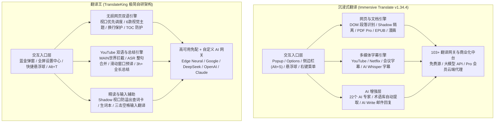
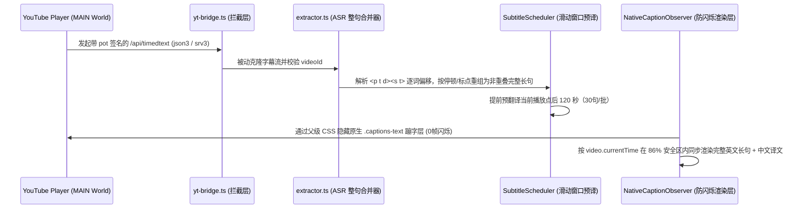

# 沉浸式翻译 (Immersive Translate) 深度功能拆解与技术架构调研报告

> **调研对象**：沉浸式翻译（Immersive Translate v1.34.4，Chrome Extension ID: `bpoadfkcbjbfhfodiogcnhhhpibjhbnh`）  
> **对比基线**：翻译王（TranslateKing v1.2.0）  
> **文档性质**：竞品产品架构拆解、核心技术原理分析与演进路线图报告  
> **编写日期**：2026-10-29

---

## 一、 执行摘要 (Executive Summary)

**沉浸式翻译 (Immersive Translate)** 是目前中文互联网用户量最大的双语对照浏览器扩展之一。其核心产品哲学是**“不破坏原网页排版的原位双语对照（Bilingual In-Place Rendering）”**，并在此基础上逐步横向扩展出 **网页翻译、视频双语字幕、PDF/EPUB 文档翻译、图片/漫画翻译、输入框三击空格翻译、AI 专家与术语库** 六大业务矩阵。

但与此同时，沉浸式翻译经过多轮商业化迭代后，打包体积已膨胀至 **20MB+**，包含大量会员计费墙（Pro / Max 分层）、云端控流与百余个冗余服务配置。本报告对其全部 15 大模块进行完整解构，并与 **翻译王 (TranslateKing)** 的现有实现做逐项技术对标，提炼出真正值得吸收的工程精华。

---

## 二、 系统级架构对比总览

| 核心维度 | 沉浸式翻译 (Immersive Translate) | 翻译王 (TranslateKing) | 技术评估 |
| :--- | :--- | :--- | :--- |
| **构建体积** | ~20 MB+（含大量静态规则包、WASM 与多端 SDK） | **~180 KB**（核心脚本 125 KB，瘦身 99%） | 翻译王冷启动与内存开销极具优势 |
| **默认开箱体验** | 免费源限频明显，高阶模型/双语 SRT 下载需开通 Pro 会员 | **内置微软 Edge 神经网络 + Google 双专线，零配置免费** | 翻译王无付费墙阻碍 |
| **双语 SRT 字幕下载** | 仅限付费 Pro 会员导出 | **完全免费一键导出 `.SRT` 双语时间轴字幕** | 翻译王直接开放核心刚需 |
| **YouTube 长视频总结** | 依赖外部或侧边栏组件 | **原生内嵌右侧面板，支持 3+ 小时全时长覆盖与时间戳跳转** | 翻译王与播放器融合度更高 |
| **隐私安全** | 含账号体系、用量统计上报与遥测开关 | **100% 本地存储 + 浏览器直连翻译网关，零遥测** | 翻译王隐私保护更彻底 |

---

## 三、 十五大功能模块深度拆解与技术原理

### 模块 1：网页翻译核心引擎 (Webpage Bilingual Engine)

#### 1.1 功能细节
- **翻译模式**：双语对照模式（原文 + 译文上下排列） vs 仅看译文模式（直接替换原文）。
- **翻译范围控制**：
  1. 翻译整页（含导航栏、侧边栏、页脚）；
  2. 仅翻译主要内容区域（基于 Readability 启发式算法识别 `<article>` / `<main>` 正文区）；
  3. 立即翻译到页面底部（关闭视口懒加载，一次性并发翻译全页所有段落，适合长文打印或离线保存）。
- **译文样式系统**：
  - 提供虚线、下划线、模糊遮罩（学习模式）、引用边栏、高亮背景等主题；
  - 支持自定义译文字体（宋体、雅黑等）、字号比例、字重、颜色及译文位置（原文上方/下方）。
- **交互增强**：
  - **译文可编辑**：允许用户直接在网页上修改不准确的译文（适合截图分享前微调）；
  - **网站级规则矩阵**：内置永久自动翻译白名单（如 `x.com`、`reddit.com`、`news.ycombinator.com`）、永不翻译黑名单，以及按域名指定特定翻译引擎。

#### 1.2 底层技术原理与翻译王对比
- **DOM 切分与换行保留**：网页评论区（如 YouTube `#content-text`、Reddit 评论）大量使用 ` ` 或 `white-space: pre-wrap` 的 `\n` 换行。若直接读取 `.textContent` 会丢失所有段落空行。**翻译王已实现 ` ` 与 `\n` 语义分段翻译重组算法**，在「双语对照」和「仅看译文」下均 100% 保留原帖排版。
- **待补充项**：
  - 「仅翻译正文区 vs 翻译整页」的范围切换开关；
  - 「网页译文双击原位编辑」能力（方便用户微调后截图）。

---

### 模块 2：翻译服务与并发聚合网关 (`#services`)

#### 2.1 功能细节
沉浸式翻译在 `#services` 页面内置了 **103 个翻译服务配置**，分为三层：
1. **免费在线通道**：微软 Bing、Google 翻译、腾讯交互翻译 Transmart、智谱 `GLM-4-Flash`（官方免费 API）、硅基流动（SiliconFlow 免费小模型）等；
2. **AI 大模型通道**：DeepSeek、OpenAI、Claude、Gemini、OpenRouter、火山方舟（豆包）、阿里云百炼（通义千问）、Groq、**Ollama（本地离线大模型）** 等；
3. **传统机器翻译云 API**：DeepL / DeepLX、百度翻译、有道翻译、彩云小译、小牛翻译等。

#### 2.2 核心工程机制
- **请求分批聚合协议 (Batching & Delimiter Protocol)**：
  面对网页上 100+ 个碎片段落，不会发起 100 次独立请求，而是将 8~15 个段落通过特殊分隔符（如 `\n\n%%\n\n` 或 JSON 数组编号）打包为单次请求发送给大模型，返回后再按序号拆解回填。
- **令牌桶限流器 (Token Bucket Rate Limiter)**：
  每个服务可独立配置「每秒最大请求数 (QPS)」与「单次最大字符数」，防止触发 HTTP 429。
- **AI 智能上下文 (Context-Aware Prompting)**：
  在调用大模型翻译时，自动注入当前网页的 `<title>`、域名及前文摘要作为 System Prompt 背景知识，显著消除代词指代不明与一词多义误译。

---

### 模块 3：视频双语字幕引擎 (Video Dual Subtitles)

#### 3.1 沉浸式翻译的核心做法（为什么它不会逐词蹦字？）
YouTube 的自动生成字幕（ASR，`kind=asr`）在原生播放器中使用 `.ytp-caption-window-rollup`（滚动窗口模式），每 150ms 往最后一行 `.caption-visual-line` 追加一个 `` 单词。
如果插件直接在原生 DOM 上监听文字变化并翻译：
1. 每秒会触发 6~8 次残缺短语翻译请求；
2. 新蹦出的英文单词会被 YouTube 内核直接塞进插件注入的译文行后面；
3. 每次 YouTube 重绘节点都会造成剧烈闪烁。

**沉浸式翻译与翻译王目前共同采用的终极架构**：

#### 3.2 沉浸式翻译额外具备的视频扩展能力
- **多平台适配**：除 YouTube 外，还适配了 Netflix、Disney+、Udemy、Coursera、Bilibili、TED 等数十个流媒体平台；
- **在线会议实时字幕翻译**：支持 Google Meet、Zoom Web、Microsoft Teams 网页版的实时滚动字幕双语化；
- **AI 语音转写字幕 (Pro 专属)**：针对完全没有任何字幕轨（连自动英文字幕都没有）的生肉视频，提取音频流发送至云端 Whisper 模型生成时间轴字幕。

---

### 模块 4：鼠标悬停翻译 (Mouse Hover Translation)

- **交互逻辑**：用户无需开启整页翻译，只需将鼠标指针悬停在想要阅读的外文段落上并按住 `Ctrl` 键（或设置为直接悬停 400ms），即可仅将该段落原位展开为双语对照；再次按 `Ctrl` 即可还原。
- **适用场景**：适合外语水平较好、仅在遇到长难句时才需要辅助翻译的用户，避免整页双语带来的视觉信息过载。

---

### 模块 5：划词翻译 (Selection Lookup)

- **沉浸式翻译做法**：选中文本后弹出翻译面板，支持切换多个翻译源对比，长句支持调用 Pro 大模型进行语法剖析。
- **翻译王优势**：翻译王不仅支持长句翻译，还专门集成了**有道英汉/汉英双音标词典、真人 TTS 原声朗读、上下文所在整句自动提取以及本地生词本收藏**，并配备了基于 `getBoundingClientRect()` 的视口防溢出自适应滚动容器。

---

### 模块 6：输入框翻译 (Input Box Translation)

- **核心交互**：在任意网页的 `<input>`、`<textarea>` 或 `contenteditable` 富文本编辑器（如 Twitter/X 发帖框、GitHub Issue、Discord 聊天框、Gmail）中用母语输入文字后，**连续按 3 下空格键（`Space × 3`）**，立即将输入框内的文字替换为地道的目标外语。
- **进阶可配项**：支持自定义触发前缀（如 `/translate`）、自动识别当前聊天窗口对方的语言、以及富文本编辑器黑名单（如默认排除飞书文档、Notion 编辑器以防误触）。

---

### 模块 7：侧边悬浮球 (Floating Action Ball)

- **沉浸式翻译做法**：停靠在屏幕右侧边缘，支持拖拽上下位置、设置半透明缩小态；鼠标悬停在悬浮球上时会滑出子菜单（切换双语/仅译文、打开侧边栏、打开设置、在此网站禁用）。
- **翻译王现状**：已实现右侧可拖拽、状态同步的快捷双语切换悬浮球；后续可扩展「悬停展开快捷胶囊抽屉」功能。

---

### 模块 8：AI 增强套件 (AI Experts / Glossary / AI Write)

1. **AI 专家角色预设 (22 种 Persona Prompts)**：
   - 针对不同体裁提供专属 System Prompt：如「学术论文译者（严谨术语、被动语态规整）」、「Twitter/Reddit 冲浪专家（保留网络梗与俚语神韵）」、「技术文档专家（保留代码变量与 API 名不翻译）」、「小说文学译者」、「金融/法律顾问」等。
2. **自定义术语库 (Glossary / Terminology)**：
   - 允许用户配置强制词表（例如强制将 `Agent` 译为 `智能体` 而非 `代理`，或保持 `Transformer` 原词不译），并在大模型 Prompt 或后处理阶段自动注入生效。
3. **AI Write 智能回复助手**：
   - 在 Gmail、Outlook、GitHub、Twitter 回复框旁注入 `[AI Reply]` 按钮，根据上文自动生成不同语气（正式/友好/简洁）的外语回复草稿。

---

### 模块 9：文档、图片与漫画翻译 (Document & Image OCR)

1. **本地文档双语翻译**：
   - 支持打开本地 `TXT`、`Markdown`、`HTML`、`SRT/VTT 字幕文件`、`EPUB 电子书` 及 `PDF` 文档进行双语对照阅读并导出双语文件。
2. **图片与漫画翻译**：
   - 右键点击网页图片触发「翻译图片」，通过 OCR 识别图中文字框坐标，擦除原文字并在原位置渲染译文图层。

---

## 四、 翻译王 (TranslateKing) 下一阶段可吸收的高价值特性清单

结合本次调研，在保持翻译王 **「极致轻量、零广告零付费墙、纯本地隐私安全」** 核心优势的前提下，最值得参考沉浸式翻译引入的 4 项功能为：

| 优先级 | 特性名称 | 实现方式与技术成本 | 用户价值 |
| :---: | :--- | :--- | :--- |
| **P0** | **按住 `Ctrl` 鼠标悬停单段翻译** | 监听 `mousemove` + `keydown(Control)`，复用现有 `extractor` 与 `injector` 单段挂载（约 80 行代码） | 按需指哪翻哪，不打扰整页阅读 |
| **P1** | **AI 专家角色预设 + 自定义术语表** | 在设置中心「翻译服务」下新增专家下拉框（通用/学术论文/Twitter俚语/程序员技术文档）与 `原文=译文` 术语表注入 Prompt | 大模型翻译专业度提升一个量级 |
| **P1** | **免费大模型与本地 Ollama 预设** | 在 AI 引擎列表新增 **智谱 GLM-4-Flash（免费）**、**硅基流动（免费额度）**、**本地 Ollama (`localhost:11434`)** 一键模板 | 零成本享受大模型高质量翻译 |
| **P2** | **网页译文双击原位微调编辑** | 为 `.translate-king-block` 支持快捷键/双击进入 `contenteditable="true"` 微调模式 | 方便用户修正个别词后截图分享 |
