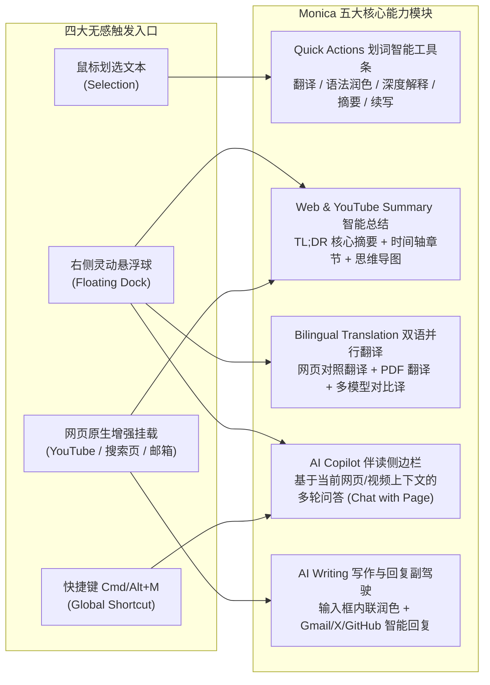

# Monica (monica.im) 全能 AI 浏览器助手产品交互与技术架构深度调研报告

> **调研对象**：Monica AI 浏览器扩展（`https://monica.im`）  
> **对比基线**：翻译王（TranslateKing v1.2.0）  
> **文档性质**：竞品 UX 交互范式拆解、技术架构分析与功能融合设计方案  
> **编写日期**：2026-10-29

---

## 一、 执行摘要 (Executive Summary)

如果说「沉浸式翻译」是**垂直翻译领域的工具标杆**，那么 **Monica (`monica.im`)** 则是 **All-in-One AI 浏览器伴侣（Browser Copilot）的交互设计标杆**。

Monica 之所以在全球获得数百万活跃用户，核心不仅在于接入了多个大模型，更在于它打磨出了三套极其丝滑的**前端微交互范式（Micro-UX Patterns）**：
1. **划词智能快捷工具条 (Quick Actions Smart Toolbar)**：划选文字时不直接弹出一整块笨重的大卡片遮挡视线，而是先浮现一个精巧的胶囊工具栏 `[译 | 解释 | 润色 | 总结]`，按需展开。
2. **悬浮球灵动抽屉 (Floating Dock & Quick Drawer)**：右侧悬浮球不仅是单一开关，鼠标放上去会像 macOS Dock 一样平滑展开一列高频动作（双语翻译、网页总结、侧边栏对话、截图提问）。
3. **结构化智能阅读伴侣 (YouTube TL;DR 章节脑图 + 网页伴读侧边栏)**：将冗长的视频与万字长文提炼为「一句话核心结论 (TL;DR) + 带时间戳结构化章节 + 交互式追问」。

本报告深度拆解 Monica 的核心功能模块与前端实现机制，并给出将其精华交互融合进 **翻译王 (TranslateKing)** 的具体技术方案。

---

## 二、 Monica 核心产品矩阵与交互全景图

---

## 三、 六大标志性模块深度拆解

### 模块 1：划词智能快捷工具条 (Quick Actions Smart Toolbar)

#### 1.1 痛点与 Monica 的交互创新
传统词典/翻译扩展在用户用鼠标选中网页文字时，存在两个极端：
- **过于激进**：只要鼠标选中文字（哪怕用户只是想复制文本或习惯性高亮阅读），立刻弹出一张 `380px × 300px` 的巨大翻译卡片，严重遮挡下方正文；
- **过于隐蔽**：只显示一个 `16px` 的小图标，用户点击后还要再选功能。

**Monica 的「两段式渐进展开（Progressive Disclosure）」设计**：
1. **第一阶段（轻量胶囊条）**：选中文本松开鼠标左键后，在选区正上方/正下方 `8px` 处浮现一个高仅 `34px` 的精致深色毛玻璃胶囊条：
   `[ 🌐 翻译 | 💡 解释 | ✨ 润色 | 📝 总结 | 🔊 朗读 | 📌 收藏 ]`
2. **第二阶段（原位平滑展开卡片）**：
   - 当用户点击 `[🌐 翻译]`（或对单个单词开启「单词直出音标释义」），胶囊条原位平滑膨胀（CSS `transform` + `height` 过渡）为完整释义/翻译卡片；
   - 当用户点击 `[💡 解释]`，调用 AI 针对该句中的专业术语、代码片段或文化背景给出通俗解析；
   - 当用户点击 `[✨ 润色]`，针对选中的英文句子给出「语法纠错 / 更地道学术表达 / 精简改写」版本。

#### 1.2 与翻译王 (TranslateKing) 结合的技术方案
翻译王目前已拥有强大的 [`FloatingCard`](file:///Users/lbw/orca/projects/chrome%20tuozhan/translate-king/src/content/selection/floating-card.ts)（Shadow DOM 隔离 + 视口防溢出计算）。我们可以在设置中提供两种模式或直接在卡片顶部集成 **Quick Actions 动作栏**：
- **单词模式（选中 1~3 个词）**：直接秒出音标、词典释义与发音；
- **长句/段落模式（选中整句或多段）**：卡片顶部自带 `[🌐 译文 | 💡 深度解析 | ✨ 语法润色 | 📋 复制]` 切换标签，一键调用已配置的 AI 引擎（DeepSeek / OpenAI / Claude / 免配网关）完成解释或润色。

---

### 模块 2：右侧悬浮球灵动抽屉 (Monica Floating Dock)

#### 2.1 交互设计细节
Monica 在浏览器右侧边缘停靠了一个半透明胶囊球，其交互分为三层：
1. **静默态**：平时半隐藏贴边（透明度 `0.65`），完全不遮挡网页阅读；
2. **悬停展开态（Hover Menu）**：当鼠标移入悬浮球时，向上/向左平滑弹出 4 个高频快捷气泡按钮：
   - `🌐 双语翻译`：一键开启/关闭当前网页双语对照（显示当前 ON/OFF 状态点）；
   - `✨ 总结此页`：一键提取当前网页文章或 YouTube 视频的核心摘要；
   - `🔍 划词开关`：临时开启/静音当前页面的划词弹窗；
   - `⚙️ 翻译设置`：快速切换目标语言或打开全屏设置中心。
3. **拖拽与站点隐藏**：支持上下自由拖拽记忆位置，并提供 `×` 按钮（「在当前网站隐藏」或「本次会话隐藏」）。

#### 2.2 与翻译王对比
翻译王目前已实现 [`src/content/floating-ball.ts`](file:///Users/lbw/orca/projects/chrome%20tuozhan/translate-king/src/content/floating-ball.ts) 的贴边拖拽与一键双语切换。升级为 **Monica 风格悬停展开抽屉** 仅需在现有 Shadow DOM 容器内增加悬停展开菜单列表，即可将操作效率提升数倍。

---

### 模块 3：YouTube 视频结构化总结与思维导图 (YouTube AI Summary)

#### 3.1 Monica 的视频总结结构
Monica 在 YouTube 视频右侧挂载总结面板时，并非平铺直叙地罗列文字，而是采用 **三层金字塔信息架构**：
1. **顶层：全片一句话摘要 (TL;DR / Key Takeaway)**
   - 在面板最顶部用高亮卡片展示 50~100 字的全片核心主旨，让用户在 3 秒内判断该视频是否值得观看。
2. **中层：带时间戳的结构化章节要点 (Timestamped Chapters & Highlights)**
   - 将视频划分为 5~12 个逻辑章节，每个章节包含：
     - `[04:15]` 可点击跳转时间戳徽章 + **章节小标题**；
     - 2~3 条带 Emoji 图标的核心论点（Bullet Points），支持一键展开/折叠详情。
3. **底层：完整双语时间轴字幕稿 (Interactive Bilingual Transcript) + 针对视频提问 (Chat with Video)**
   - 支持按关键词搜索字幕稿、跟随视频播放进度自动高亮当前正在说的段落（Auto-Scroll Sync）、一键导出字幕或 Markdown 笔记。

#### 3.2 与翻译王现有 [`YouTubeSummaryPanel`](file:///Users/lbw/orca/projects/chrome%20tuozhan/translate-king/src/content/youtube/summary-panel.ts) 对比
- **翻译王已具备**：全时长覆盖（支持 3+ 小时视频不截断）、带 `[MM:SS]` 时间戳章节要点、完整双语文字稿、点击时间戳跳转、一键复制、切视频缓存隔离。
- **可借鉴 Monica 升级点**：
  1. **顶部 TL;DR 全片核心摘要卡**：在章节列表上方增加全片核心概览卡片；
  2. **文字稿关键字实时搜索框 & 播放进度跟随高亮（Auto-Scroll）**：在「双语文字稿」Tab 顶部加一个搜索框，并支持随视频播放自动高亮当前时间段的文字稿；
  3. **导出为 Markdown 笔记**：除复制纯文本外，支持一键下载结构化 `.md` 视频学习笔记。

---

### 模块 4：网页伴读与通用文章总结 (Webpage Summary & Chat with Page)

#### 4.1 功能场景
当用户打开一篇万字英文技术博客、新闻报道、Hacker News 讨论串或 Wikipedia 词条，不想从头读到尾时：
- 点击悬浮球的 `✨ 总结此页`（或按快捷键），右侧滑出精美的抽屉面板：
  1. **文章核心摘要 (TL;DR)**；
  2. **关键要点列表 (Key Takeaways)**；
  3. **针对本文提问 (Ask about this page)**：自动提取当前网页正文作为上下文，用户可以直接输入中文问题（如“这篇文章提到的性能瓶颈是什么？”、“作者推荐哪种方案？”），由 AI 基于网页原文精准作答。

---

### 模块 5：多模型并行翻译对比 (Parallel Multi-Engine Translation)

- **功能设计**：在独立翻译面板或划词长句翻译中，支持同时展示 **免费神经网络网关 + DeepSeek + OpenAI / Claude** 的翻译结果，让用户直观对比不同引擎的译文质量并一键采纳最佳译文。

---

### 模块 6：输入框写作副驾驶 (Compose & Reply Copilot)

- **功能设计**：除三击空格直接翻译外，在输入框旁提供微小的火花图标 `✨`，支持对已输入的草稿进行：
  - **语法纠错 (Fix Grammar)**
  - **语气转换 (Make Professional / Friendly / Concise)**
  - **扩写/缩写 (Expand / Shorten)**

---

## 四、 翻译王 × 沉浸式翻译 × Monica 横向功能对比矩阵

| 功能领域 | 细分能力 | 沉浸式翻译 | Monica | 翻译王 (当前版本) | 建议演进策略 |
| :--- | :--- | :---: | :---: | :---: | :--- |
| **网页双语翻译** | 双语对照 / 仅看译文 / 快捷键 `Alt+T` | ✅ | ✅ | ✅ **已实现** | 保持 |
| | 6 款双语视觉主题（含引用线/护眼黄/无框/模糊遮罩） | ✅ | ❌（样式单一） | ✅ **已实现** | 翻译王已领先 Monica |
| | 多行评论换行保留 / 维基百科 TOC 与引用保护 | ⚠️ 偶有破坏 | ⚠️ 一般 | ✅ **已深度优化** | 保持核心优势 |
| | 按住 `Ctrl` 鼠标悬停单段即时翻译 | ✅ | ❌ | ⏳ 待补充 | **推荐纳入 P1** |
| **YouTube 视频** | 播放器内双语字幕 + 多维样式控制台 | ✅ | ⚠️ 较简陋 | ✅ **已实现** | 保持 |
| | ASR 自动语音字幕整句合并 + 零闪烁防溢出 | ✅ | ❌ | ✅ **已实现** | 保持 |
| | 免费一键导出双语 `.SRT` 字幕文件 | 💰 需付费 Pro | ❌ | ✅ **免费内置** | 翻译王独有免费优势 |
| | 3+ 小时全时长视频时间轴章节总结 + 双语文字稿 | ❌（需外接） | ✅ | ✅ **已实现** | 可增加 Monica 式 **TL;DR 摘要 + 文字稿搜索/跟随高亮** |
| **划词与精读** | 双音标词典 + 真人发音 + 本地生词本 + 视口防溢出 | ⚠️ 无生词本 | ⚠️ 偏重 AI | ✅ **已实现** | 保持 |
| | **Quick Actions 划词操作栏**（翻译/解释/语法润色） | ❌ | ✅ **核心亮点** | ⏳ 待补充 | **强烈推荐融合进划词卡片顶部** |
| **悬浮球与侧栏** | 右侧贴边拖拽悬浮球 | ✅ | ✅ | ✅ **已实现** | 保持 |
| | **悬浮球悬停展开灵动菜单**（双语/总结网页/划词开关/设置） | ✅ | ✅ **核心亮点** | ⏳ 待补充 | **强烈推荐升级现有悬浮球** |
| | **通用网页一键总结 & 伴读问答 (Chat with Page)** | ❌ | ✅ **核心亮点** | ⏳ 待补充 | **可复用现有 YouTube 总结面板架构扩展至任意网页** |
| **输入与写作** | 三击空格 (`Space × 3`) 输入框实时转外语 | ✅ | ❌ | ✅ **已实现** | 保持 |
| **翻译引擎与设置** | 独立全屏设置中心 + 黑白名单 + 导入导出备份 | ✅ | ✅ | ✅ **已实现** | 可增加 **AI 专家角色预设 + 自定义术语表 + 免费大模型预设** |

---

## 五、 翻译王下一步融合演进路线图 (Actionable Roadmap)

基于以上两份深度调研报告，**翻译王 (TranslateKing)** 已经完成了最硬核的底层基建（网页无损双语引擎、YouTube ASR 整句无闪烁双语字幕、3 小时全长视频总结面板、视口防溢出划词词典、三击空格翻译、全屏设置中心）。

未来若要将产品体验推向极致，可以按以下三个模块择优迭代：

### 阶段一：Monica 风格微交互升级（颜值与顺手度质的飞跃）
1. **悬浮球升级为「灵动快捷抽屉 (Floating Quick Dock)」**：
   - 鼠标移入右侧悬浮球时平滑展开：`[🌐 双语开关]`、`[✨ 总结当前页/视频]`、`[🔍 划词开关]`、`[⚙️ 设置中心]`。
2. **划词卡片集成「Quick Actions 智能动作栏」**：
   - 在划词浮窗顶部增加 `[🌐 翻译 | 💡 解释 | ✨ 润色]` 快捷切换，选中晦涩长句或专业术语时可一键让 AI 深度拆解或润色英文表达。

### 阶段二：沉浸式翻译风格专业度升级（翻译质量进阶）
3. **按住 `Ctrl` 鼠标悬停单段翻译**：
   - 指哪翻哪，再次按下即还原。
4. **AI 专家角色预设 + 自定义术语表 + 免费大模型一键预设**：
   - 内置「通用 / 学术论文 / Twitter 俚语 / 程序员技术文档」专家模式；
   - 支持配置自定义术语表（如固定专有名词译法）；
   - 新增 **智谱 GLM-4-Flash（免费 API）**、**硅基流动**、**Ollama 本地模型** 一键预设。

### 阶段三：全网伴读与视频总结增强
5. **YouTube 总结面板增强 & 通用网页总结支持**：
   - 为视频总结面板增加顶部 **TL;DR 核心摘要卡**、**文字稿关键词搜索**、**随视频播放自动滚动高亮当前句** 以及 **一键导出 Markdown 笔记**；
   - 将总结面板复用于普通外文长文网页（点击悬浮球 `[✨ 总结此页]` 即可提炼任意网页文章大纲与核心要点）。
