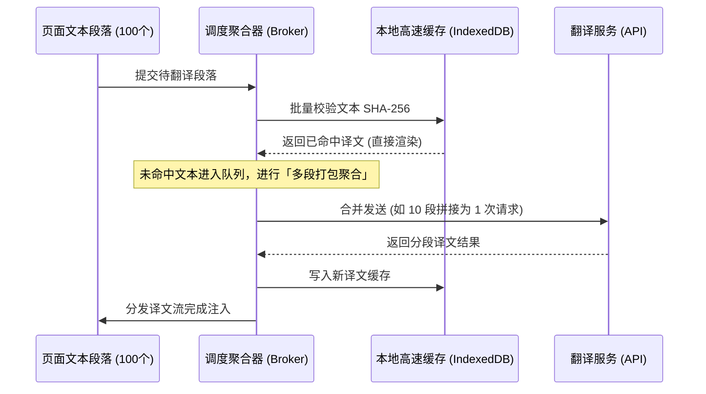
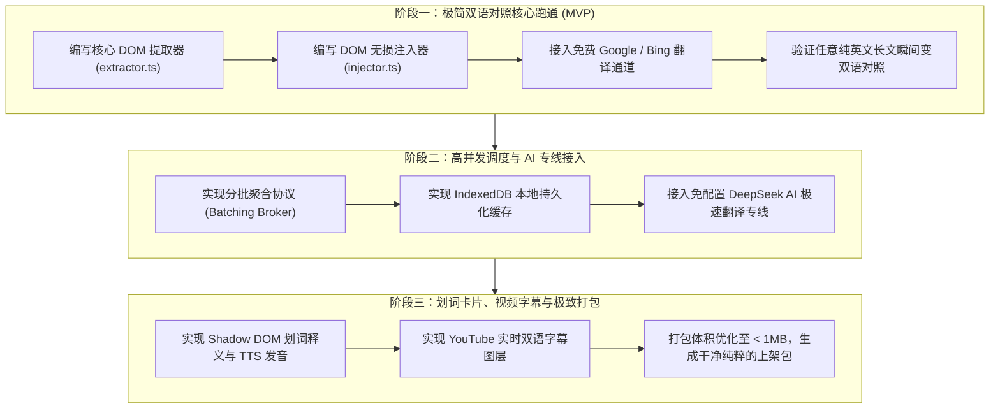

# 翻译王 (TranslateKing) 系统架构白皮书与功能自主复现设计方案

> **文档版本**：v1.0.0  
> **编写目标**：彻底解构沉浸式双语翻译（如“沉浸式翻译”、“流畅阅读”）的底层实现机制，摆脱第三方开源庞大冗余的源码包袱，输出清晰严谨的技术架构规范，并指导完成 100% 自主可控、轻量高效（打包 < 1MB）的核心功能复现。

---

## 一、 为什么要做自主技术复现？

传统双语翻译扩展虽然概念丰富，但在工程上普遍存在明显的“历史包袱”：
1. **体积臃肿**：引入了大量离线分词包、未裁剪的 WASM 模块、测试基准和各类过剩功能，打包后接近 20MB。
2. **代码资产混杂**：夹杂原作者的私有域名、支付赞赏、专用证书密钥和外链，清洗维护极其痛苦。
3. **架构过度设计**：单是多语言和状态分发就封装了数十层适配器，对于自主迭代和排查 Bug 极不透明。

**翻译王复现目标**：
* **代码纯粹度 100%**：无任何第三方引流代码与无关依赖。
* **体积极致轻巧**：核心包体积控制在 **1MB 以内**（加载快 10 倍，内存占用减小 80%）。
* **架构高内聚**：仅包含 5 大清晰模块，注释严整，规范统一。

---

## 二、 沉浸式双语翻译的核心技术原理

沉浸式翻译之所以“沉浸”，其核心在于：**不跳转页面、不破坏网页原有排版、在原文下方紧随显示高质感译文，且支持流式追加与悬浮微交互。**

```
┌─────────────────────────────────────────────────────────────────┐
│                      网页 DOM 树 (Webpage)                       │
└────────────────┬───────────────────────────────▲────────────────┘
                 │ 1. 抓取段落                    │ 4. 插入双语译文
                 ▼                               │
┌──────────────────────────────────┐             │
│    DOM 解析与智能切分过滤引擎      │             │
│ (Node Walker & Content Filter)   │             │
└────────────────┬─────────────────┘             │
                 │ 2. 待翻译文本块                 │
                 ▼                               │
┌──────────────────────────────────┐             │
│   并发调度与分批聚合网关 (Broker)  │             │
│   - SHA-256 智能缓存             │             │
│   - 10 段聚合合并 (Batching)     ├─────────────┘
└────────────────┬─────────────────┘
                 │ 3. 统一请求 API
                 ▼
┌──────────────────────────────────┐
│   翻译后端适配层 (Provider)      │
│   - Google / Bing 免费免 Key 通道 │
│   - DeepSeek / OpenAI AI 专线    │
└──────────────────────────────────┘
```

---

## 三、 核心模块深度拆解与算法设计

### 模块 1：DOM 智能解析与双语无损注入引擎 (`core/dom/`)

#### 1. 智能块级文本节点识别算法 (Translatable Node Filter)
在网页中，盲目遍历所有文本节点会导致网页错乱。必须通过启发式规则判定哪些是“承载语义的段落”：

* **有效候选容器 (Valid Block Containers)**：
  `p`, `h1`~`h6`, `article`, `section`, `blockquote`, `li`, `td`, `figcaption`。
* **严格忽略的噪声标签 (Blacklist Tags)**：
  `script`, `style`, `svg`, `code`, `pre`, `noscript`, `input`, `textarea`, `select`, `video`, `audio`。
* **排除规则 (Exclusion Rules)**：
  - 含有 `translate="no"` 属性或 class 包含 `notranslate`。
  - 内容全为数字、标点符号、单个单词或纯空格。
  - 属于页面导航栏或版权页面的微型碎片（字符长度小于阈值，如 `< 3` 且无外文字符）。

#### 2. 无损双语挂载策略 (DOM Injection)
为了防止现代响应式 CSS（如 `flex`, `grid`, `inline-flex`）发生布局坍塌，译文的挂载方式必须遵循以下规范：

```html
<!-- 原网页结构 -->
<p class="article-text">
  Artificial Intelligence is rapidly evolving.
  
  <!-- 翻译王挂载的独立容器：挂载在原元素末尾内部，或紧跟其后的同级 -->
  <span class="translate-king-wrapper" data-tk-state="translated">
    <span class="translate-king-separator"></span>
    <span class="translate-king-text">人工智能正在迅速发展。</span>
  </span>
</p>
```
* **样式完全隔离**：翻译容器的所有 CSS 属性重置为 `all: initial`，再声明特定样式，避免原站 CSS 继承污染。
* **状态持久跟踪**：使用 WeakMap 或 `data-tk-id` 记录原文与译文的绑定关系，确保用户切换开关时可瞬间无缝恢复原文。

---

### 模块 2：高并发翻译聚合调度与缓存网关 (`core/broker/`)

如果页面上有 100 个段落，直接发 100 次 HTTP 请求会导致浏览器网络拥塞并被翻译服务封禁 IP（Rate Limit）。



#### 关键优化技术：
1. **分段合并协议 (Batch Aggregation)**：
   将 10 个独立段落使用特定分隔符（如 `\n\n===TK_SPLIT===\n\n`）拼接成一个请求发送给大模型或免费翻译源，收到结果后再精准切割拆解。**节省 90% 请求频次，同时大模型能感知完整上下文，翻译质量大幅跃升！**
2. **两级智能缓存 (Two-tier Cache)**：
   - **L1 内存缓存**：当前会话内即时查重。
   - **L2 本地持久缓存 (IndexedDB)**：以 `hash(source_lang + target_lang + text)` 为 Key，相同网页二次刷新 0 秒加载，完全免 API 消耗。

---

### 模块 3：Shadow DOM 划词精读浮窗与生词本 (`core/selection/`)

用户在网页上选中文本时，必须在光标右上方弹出一个优雅的释义小卡片。

* **样式防御 (Shadow DOM)**：
  浮窗必须挂载在原生 `attachShadow({ mode: 'open' })` 内部！这样宿主页面的任何全局样式（哪怕设置了 `* { color: red !important; }`）都无法影响到翻译卡片的外观。
* **视口越界碰撞检测 (Boundary Snapping)**：
  根据选区 `window.getSelection().getRangeAt(0).getBoundingClientRect()` 动态计算 `left` 和 `top`，当靠近屏幕最右侧或底部时，自动反转对齐方式（向上/向左弹出），避免被视口裁剪。
* **原生语音朗读 (Web Speech TTS)**：
  直接调用浏览器自带的 `window.speechSynthesis` 引擎，无需下载任何语音包文件，零网络流量消耗，纯离线秒级真人发音。

---

### 模块 4：YouTube / 在线视频实时双语字幕引擎 (`core/subtitle/`)

针对 YouTube 等主流在线视频：
1. **播放器挂钩 (Video Hook)**：定位 HTML5 `<video>` 元素，监听 `timeupdate` 事件。
2. **字幕流拦截 (Caption Interceptor)**：
   - 方式 A：拦截播放器的官方 CC 字幕轨道（Webvtt / TimedText JSON），提前翻译字幕段并按时间戳建立映射表。
   - 方式 B：监听播放器原生的 Subtitle Container DOM 变动，一旦出现英文字幕，实时拦截提取并追加渲染双语字幕。
3. **高对比度双语字幕渲染层 (Subtitle Overlay)**：
   在视频上方创建独立图层，利用 CSS `text-shadow` 描边与沉浸式半透明背景，确保在任何复杂背景画面下均清晰易读。

---

## 四、 全新工程目录拓扑（基于 Clean Architecture）

我们复现的新代码将遵循极简、标准、无冗余的工程结构：

```text
translate-king-clean/
├── manifest.json              # 纯净 MV3 清单规范
├── src/
│   ├── background/            # 后台服务 Worker (网络中转/跨域/存储)
│   │   └── index.ts
│   ├── content/               # 注入页面的核心脚本
│   │   ├── index.ts           # 消息监听与生命周期初始化
│   │   ├── dom/               # DOM 智能解析、过滤与译文注入
│   │   │   ├── extractor.ts   # 文本节点提取器
│   │   │   └── injector.ts    # 双语排版渲染器
│   │   ├── selection/         # 划词浮层 (Shadow DOM)
│   │   └── subtitle/          # 视频字幕监听挂钩
│   ├── core/                  # 业务逻辑与公共核心
│   │   ├── broker/            # 并发调度聚合器与队列管理
│   │   ├── cache/             # IndexedDB 缓存存储
│   │   └── providers/         # 翻译源适配器 (Google, DeepSeek, Bing)
│   ├── popup/                 # 点击图标弹出的现代化极简设置窗
│   └── options/               # 完整功能设置页
├── package.json               # 极简依赖库 (仅 原生TS/Vite，无任何臃肿包)
└── vite.config.ts             # 极速打包配置 (打包后体积 < 1MB)
```

---

## 五、 自主复现三阶段实施路线图


